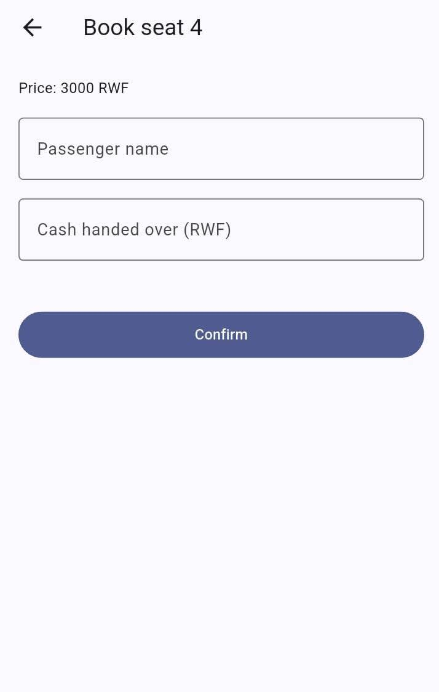
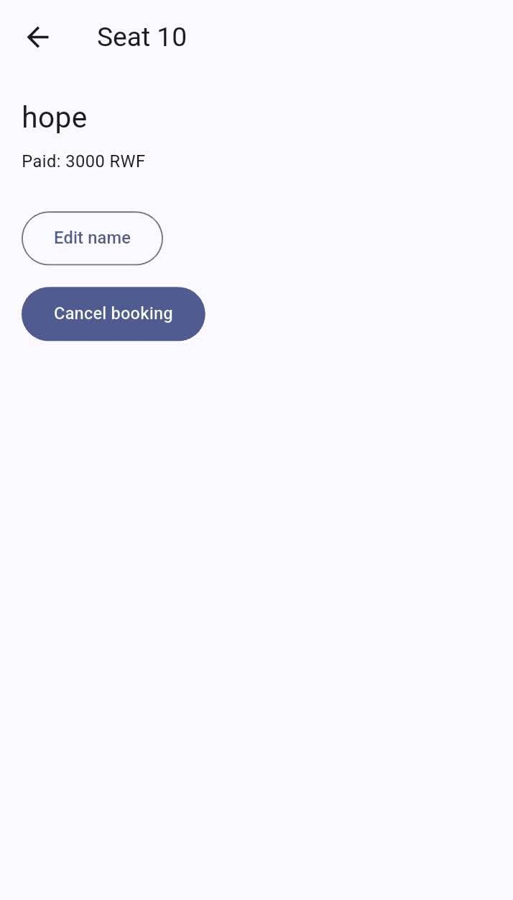

# Horizon Express

Book a seat on the Horizon Express bus to Huye: see which of the 12 seats
are free, book yours, and manage your bookings from any phone.

## Download
[Download the latest APK](https://github.com/Hope-05/bus_booking/releases/latest)
(for Android phones)

## Features
- Create an account and log in
- Seat map showing which seats are free and which are booked
- Book a seat, with cash paid and change calculated
- View booking details and cancel a booking
- Waiting list that promotes people automatically when a seat is freed
- Your bookings are saved online and private to your account

## Screenshots
| Seat map | Book a seat | Booking details |
|---|---|---|
|  |  |  |

## How it's built
- Flutter
- Firebase Authentication and Cloud Firestore
- Four layers: models, repositories, state, screens

## Run it yourself
1. Clone the repository and run `flutter pub get`.
2. Connect your own Firebase project (add your own `google-services.json`).
3. `flutter run`

## Author
Batamuriza Hope: [GitHub](https://github.com/Hope-05)